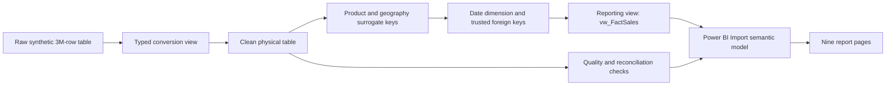

# ENTERPRISE GLOBAL BUSINESS ANALYTICS — 3M
## Production-Grade Product Requirements Document (PRD) and Antigravity Implementation Handoff

**Version:** 1.0  
**Prepared:** 25 October 2026  
**Project owner / brand:** Datta Sable — https://dattasable.com  
**Target delivery:** Public GitHub portfolio repository, reproducible SQL Server 2022 / SSMS 22 transformation workflow, professional Power BI Desktop report, supporting documentation and optional lightweight web showcase  
**Primary audience:** Hiring managers, BI engineers, data analysts, technical reviewers, recruiters and learners  
**Implementation agent:** Antigravity (or equivalent coding agent)  
**Status:** Requirements and implementation plan. Some underlying SQL/Power BI artifacts already exist; all unverified items must be inspected before claiming completion.

---

# 1. EXECUTIVE DIRECTIVE TO ANTIGRAVITY

You are acting as a senior BI architect, SQL Server data engineer, Power BI developer, data-quality specialist, GitHub documentation engineer, QA engineer and accessibility-conscious visual designer. **Work inside the existing project/repository and preserve all user work.** Build a professional, truthful, reproducible GitHub portfolio showcasing a 3-million-transaction synthetic business analytics pipeline and nine-page Power BI report.

**Do not start by rewriting or deleting existing files.** First inventory the repository, actual SQL scripts, Power BI files, datasets, images and documentation. Produce a gap analysis mapping this PRD to existing deliverables. Then implement incrementally, with test evidence and explicit approval gates for destructive actions, database schema mutations, heavy database operations, external publication or large binary commits.

**Never claim a feature is implemented merely because it is illustrated in a reference image.** Design mockups are visual direction, not data evidence. No invented performance benchmarks, predictive accuracy, exchange rates, SQL results, certification claims or business metrics. Distinguish `IMPLEMENTED`, `VERIFIED`, `PLANNED`, `BLOCKED`, and `NOT TESTED`.

## 1.1 Success definition

The repository must let a reviewer understand, reproduce and assess the full journey:

1. Original synthetic source and its known generator defects.
2. Safe type conversion and cleaning in SSMS 22.
3. Financial, date, key, geography and product validation.
4. SQL dimensions, relationships and reporting view.
5. Power BI Import model, relationships and DAX.
6. Nine well-designed, consistent report pages.
7. Accurate handling of multi-currency finance and customer-identity limitations.
8. Clear installation/reproduction instructions and visual proof.
9. GitHub-friendly assets, licensing, release process and privacy safeguards.

# 2. VERIFIED BASELINE AND KNOWN CONSTRAINTS

The following facts come from the project's working session. Reconfirm against actual files/database where available; do not silently overwrite them.

| Topic | Verified or observed baseline |
|---|---|
| SQL platform | SQL Server 2022 Developer Edition, SSMS 22, local SQL instance |
| Database | `[3 _M]` (name includes a space) |
| Raw table | `dbo.world_business_data_3m`, 3,000,000 rows, 49 original columns, originally VARCHAR(50) |
| Typed staging | `dbo.vw_Enterprise_Business_Analytics` |
| Clean physical table | `dbo.world_business_data_3m_clean` |
| Reporting SQL view | `dbo.vw_FactSales` — observed in Power BI, 19 reporting columns |
| Product dimension | `dbo.DimProduct`: 15 products |
| Geography dimension | `dbo.DimGeography`: 50 countries, 42 currencies |
| Date dimension | `dbo.DimDate`: 2,191 calendar dates, 2021-01-01 through 2026-12-31 |
| Order coverage | 2021-10-12 through 2026-10-11 |
| Order identifiers | 3,000,000 distinct `order_id`; 3,000,000 distinct `record_id` and `transaction_id` |
| Power BI | Imported `vw_FactSales`, `DimDate`, `DimProduct`, `DimGeography` |
| Relationships | Three visible one-to-many dimension-to-fact relationships |
| Date relationship | `DimDate[FullDate]` → `vw_FactSales[order_date]` |
| Measures created | Total Orders, Total Units Sold, Average Units Per Order |
| Dashboard test | Country slicer filters the three KPI cards successfully |
| Displayed baseline | 3M orders; approximately 16M units; approximately 5.50 units per order |
| Power BI project | User has saved a PBIX, actual filename/location must be inspected |
| Presentation direction | Premium corporate light dashboard, deep-navy sidebar, luminous digital globe, clean white/pale-blue canvas, minimal restrained blue accents |

## 2.1 Critical data-quality findings

- **Currency:** The source uses **42 distinct currency codes** across 50 countries. Amounts (`revenue`, `cost`, `profit`, `tax_amount`, `unit_price`) are in source/local currencies. A global sum of these values is not a valid monetary KPI. The historical raw aggregate `18,720,460,798.92` for revenue is a cross-currency arithmetic sum, **not** USD or meaningful consolidated revenue. Do not show it as a global financial result.
- **Customer identity:** The source has approximately 950,127 distinct `customer_id` values, but many IDs are associated with different names and countries. Therefore unique-customer counts, retention, repeat-customer rates, CLV and cohorts based on these IDs are **not verified**. Do not imply the IDs represent actual unique people.
- **Product identity:** The original 15 `product_id` values map inconsistently to all 15 product names. `DimProduct` was therefore constructed using the stable combination of `product_name`, `product_category`, `brand` and a surrogate `ProductKey`. Do not join using original `product_id`.
- **Synthetic date adjustment:** Dates in the cleaned table were shifted **81 days backward** for the demonstration timeline. Original raw table remains unchanged. Explicitly document this transformation and its synthetic-only nature.
- **Delivery semantics:** `planned_delivery_date` exists for all records; `actual_delivery_date` is populated only when `order_status = 'Delivered'`. Blank actual dates for other statuses are expected, not errors.
- **Finance integrity:** Verified `profit ≈ revenue - cost` to cent-level tolerance; quantity 1–10; discount 0–25%; source tax rates approximately 0, 5, 10, 15, 18 and 20%; do not conflate tax with revenue.
- **Forecasts:** A reference design may depict forecasts and accuracy figures. **No trained forecasting model or measured accuracy is established.** Forecast figures shown in concept images are illustrative only and must not be represented as actual output.
- **Power BI assets:** Images and SVG/PNG icon library are visual assets; they do not implement Power BI navigation, measures or interactivity by themselves.

# 3. SCOPE AND NON-GOALS

## 3.1 In scope

- Audited GitHub repository with clean structure, useful README and licensing.
- Reproducible SQL scripts and validation queries, preserving source data.
- Semantic model documentation and Power BI report authoring guidance.
- Nine-page enterprise analytics design, based on verified fields and valid business logic.
- DAX measures, formatting, currency safeguards and explicit modeling limitations.
- Background template and icon integration, consistent navigation and report design.
- Screenshot gallery, architecture diagram, field dictionary, tests and QA evidence.
- Optional web-based GitHub Pages project showcase **only if approved and requested**; it must not masquerade as a live Power BI report.

## 3.2 Out of scope unless separately approved

- Replacing existing PBIX or SQL tables with new fabricated content.
- Publishing the local SQL database or committing a multi-gigabyte source dataset.
- Paid cloud infrastructure, Power BI Service publication, live SQL credentials, gateways, scheduled refresh or production tenant configuration.
- Actual customer retention/CLV until identities are remediated.
- Valid consolidated USD revenue until an approved, dated and sourced FX methodology exists.
- Genuine forecasting or forecast accuracy until methodology and backtesting are implemented and verified.
- Publicly redistributing copyrighted icons, Microsoft trademarks or other third-party material without rights.

# 4. TECHNOLOGY STACK

| Layer | Technology | Requirement |
|---|---|---|
| Raw data | Synthetic CSV / SQL table | Preserve immutable original or provide safe reproduction instructions |
| Database | Microsoft SQL Server 2022 Developer | T-SQL compatible with SQL Server 2022 |
| SQL IDE | SSMS 22 | Include precise run-order and expected output |
| Semantic/reporting | Power BI Desktop | Star schema, Import mode, explicit DAX measures |
| Git hosting | GitHub | Clear portfolio README, documented releases |
| Diagrams | Mermaid / SVG | Readable in GitHub |
| Icon assets | SVG + transparent PNG | Consistent, accessible usage |
| Optional site | Static HTML/CSS/JS | No server secrets, no fake analytics |
| CI | GitHub Actions, if available | Markdown/link/security checks and asset validation |

# 5. REPOSITORY STRUCTURE

Use existing repository conventions when appropriate. Proposed target layout:

```text
enterprise-global-business-analytics-3m/
├── README.md
├── LICENSE
├── CHANGELOG.md
├── CONTRIBUTING.md
├── SECURITY.md
├── .gitignore
├── .gitattributes
├── docs/
│   ├── PRD.md
│   ├── ARCHITECTURE.md
│   ├── DATA_DICTIONARY.md
│   ├── DATA_QUALITY_AND_LIMITATIONS.md
│   ├── SQL_SERVER_SETUP.md
│   ├── SQL_TRANSFORMATION_WALKTHROUGH.md
│   ├── POWER_BI_SETUP.md
│   ├── SEMANTIC_MODEL.md
│   ├── DAX_MEASURES.md
│   ├── CURRENCY_POLICY.md
│   ├── FORECASTING_METHODOLOGY.md
│   ├── VISUAL_DESIGN_SYSTEM.md
│   ├── TEST_PLAN.md
│   ├── TEST_RESULTS.md
│   └── RELEASE_CHECKLIST.md
├── sql/
│   ├── README.md
│   ├── 00_preflight_read_only.sql
│   ├── 01_source_profile.sql
│   ├── 02_create_typed_view.sql
│   ├── 03_create_clean_table.sql
│   ├── 04_delivery_dates.sql
│   ├── 05_product_dimension.sql
│   ├── 06_geography_dimension.sql
│   ├── 07_date_dimension.sql
│   ├── 08_foreign_keys.sql
│   ├── 09_reporting_view.sql
│   ├── 10_data_quality_checks.sql
│   ├── 11_performance_checks.sql
│   └── 12_sample_reporting_queries.sql
├── powerbi/
│   ├── README.md
│   ├── Enterprise_Global_Business_Analytics_3M.pbix  # only if user provides/approves
│   ├── measures/
│   │   ├── base_measures.dax
│   │   ├── finance_measures.dax
│   │   ├── date_measures.dax
│   │   └── operations_measures.dax
│   ├── theme/
│   │   └── enterprise-light-theme.json
│   └── page-specs/
│       ├── 01_executive_overview.md
│       ├── 02_sales_performance.md
│       ├── 03_product_analysis.md
│       ├── 04_customer_insights.md
│       ├── 05_region_analysis.md
│       ├── 06_order_details.md
│       ├── 07_profitability_analysis.md
│       ├── 08_return_analysis.md
│       └── 09_forecast_analysis.md
├── assets/
│   ├── backgrounds/
│   ├── icons/svg/
│   ├── icons/png/
│   ├── screenshots/
│   └── diagrams/
├── data/
│   ├── README.md
│   ├── samples/                  # small synthetic examples only
│   └── schemas/
├── tests/
│   ├── sql/
│   ├── dax/
│   └── asset_checks/
└── .github/
    ├── workflows/
    │   └── validate.yml
    └── ISSUE_TEMPLATE/
```

**Important:** The `sql/` filenames are proposed deliverables, **not proof that the exact historical scripts are available**. Recover and reconcile real scripts before creating authoritative reproducible versions. Never present reconstructed scripts as the original execution history.

# 6. SQL TRANSFORMATION PIPELINE — REPRODUCIBILITY

## 6.1 Data flow



## 6.2 Required SQL script practices

1. Every script begins with an explanatory header: purpose, prerequisites, expected duration, row-count impact, safety classification, dependencies and rollback notes.
2. Use `USE [3 _M];` and `GO` where appropriate; quote all identifiers safely.
3. Prefer `CREATE OR ALTER VIEW` for views. Do not blindly re-run `SELECT INTO` against an existing clean table.
4. Provide separate **read-only preflight** scripts for existence, schema, nulls, counts, file growth, transaction log and disk capacity.
5. Avoid `DROP TABLE`, `TRUNCATE`, `DELETE`, bulk `UPDATE`, `ALTER COLUMN`, index rebuild or other high-impact operations without approval and backups.
6. Keep the raw source immutable. Any generated replacement or sample data must be clearly marked as synthetic.
7. Add SQL validation after every stage; fail loudly on wrong row counts or missing dimension keys.
8. Document original VARCHAR typing and all conversions, null-handling and `TRY_CONVERT` rules; do not quietly coerce invalid numeric values to zero without an explicit documented policy.
9. Document the synthetic 81-day date shift, and **do not apply it twice**. Include an idempotency guard or a documented one-time migration marker.
10. Include an alternative safe path for readers without 3 million rows, using a small sample dataset.

## 6.3 Transformation stages

### Stage A — Raw profiling

- Verify 3,000,000 source rows, 49 columns and source data types.
- Check identifiers, null rates, dates, geography/currency mapping, product consistency, customer consistency, order/payment statuses, financial distributions.
- Publish a findings table distinguishing genuine validation failures from intentional synthetic-data quirks.

### Stage B — Typed view

- Use the existing typed conversion view `dbo.vw_Enterprise_Business_Analytics`.
- Verify date/numeric/bit parsing and conversion failures.
- Document all output data types and transformations; do not reconstruct unseen expressions as historical fact.

### Stage C — Physical clean table

- Materialize `dbo.world_business_data_3m_clean` only when needed and approved.
- Verify all 3M rows and primary fields.
- Preserve original raw table.

### Stage D — Delivery dates

- Preserve planned delivery date; populate actual delivery date only for delivered orders.
- Verify no actual delivery precedes order date; confirm status distribution and null semantics.
- Document one-time synthetic date adjustment and range validation.

### Stage E — Product dimension

- `dbo.DimProduct(ProductKey, product_name, product_category, brand)`.
- Exactly 15 stable products; surrogate `ProductKey` is used in reporting.
- Fact rows mapped: 3M; missing keys: zero; invalid product keys: zero.
- Original `product_id` must **not** be used as a trustworthy dimension key.

### Stage F — Geography dimension

- `dbo.DimGeography(GeographyKey, country, continent, currency)`.
- 50 countries, 42 currencies; one currency and continent per country in the current synthetic dataset.
- Fact rows mapped: 3M; missing geography keys: zero.

### Stage G — Date dimension

- `dbo.DimDate` with `DateKey` (YYYYMMDD), unique `FullDate`, year, quarter, month, year-month sorting, weekday and weekend attributes.
- 2021-01-01 through 2026-12-31 inclusive: 2,191 dates.
- Fact order dates 2021-10-12 through 2026-10-11, no unmatched dates.

### Stage H — Keys, referential integrity and reporting view

- Trusted foreign keys on product, geography and order date were observed in SQL.
- `dbo.vw_FactSales` exposes 19 reporting columns, confirmed in Power BI; verify exact definition from `sys.sql_modules` before publishing.
- Source clean table remains the system of record; reporting view avoids loading the full wide clean table again.

## 6.4 SQL validation matrix

| Check | Expected outcome |
|---|---|
| Clean row count | 3,000,000 |
| Distinct order IDs | 3,000,000 |
| Missing ProductKey | 0 |
| Missing GeographyKey | 0 |
| Missing DimDate match | 0 |
| DimProduct rows | 15 |
| DimGeography rows | 50 |
| Currency codes | 42 |
| DimDate rows | 2,191 |
| Order date bounds | 2021-10-12 to 2026-10-11 |
| Profit reconciliation | `ABS(profit - (revenue - cost)) <= 0.01` for all rows, subject to confirmed rounding |
| Product/geography/date FK | Enabled and trusted |
| Duplicate raw identifiers | 0 for `record_id`, `order_id`, `transaction_id` |
| Customer ID consistency | **Known failure**; disclose, do not falsely mark passed |
| Original product ID consistency | **Known failure**; use surrogate key |

# 7. SEMANTIC MODEL — POWER BI

## 7.1 Tables to import

- `vw_FactSales` (reporting fact view, approximately 3M records)
- `DimDate`
- `DimProduct`
- `DimGeography`
- `_Measures` (Power BI local measure home table)

**Do not also import `world_business_data_3m` or `world_business_data_3m_clean` into the report unless a justified new analytical requirement is approved.** This avoids unnecessary duplication and model confusion.

## 7.2 Required relationships

| One side | Many side | Cardinality | Cross filter | Active |
|---|---|---|---|---|
| `DimProduct[ProductKey]` | `vw_FactSales[ProductKey]` | 1:* | Single | Yes |
| `DimGeography[GeographyKey]` | `vw_FactSales[GeographyKey]` | 1:* | Single | Yes |
| `DimDate[FullDate]` | `vw_FactSales[order_date]` | 1:* | Single | Yes |

- `DimDate` should be marked as a Date table using `FullDate`; verify actual Power BI property, not merely screenshot appearance.
- Do not relate integer `DateKey` directly to date-typed `order_date`.
- Date sort columns should be configured, e.g. `YearMonth` sorted by `YearMonthSort`, month name by month number when applicable.
- Hide redundant technical keys and the `_Measures[Placeholder]` column in report view when safe.
- Disable inappropriate implicit aggregation for identifiers, key columns, unit price and percentage fields.
- Use explicit measures, display folders and clear formats.

## 7.3 Verified initial DAX

```dax
Total Orders =
DISTINCTCOUNT(vw_FactSales[order_id])

Total Units Sold =
SUM(vw_FactSales[quantity])

Average Units Per Order =
DIVIDE([Total Units Sold], [Total Orders], 0)
```

Expected unfiltered total orders: 3,000,000. Screenshot shows approximately 16M units and 5.50 units/order; exact total units must be verified in a full-precision visual or SQL query.

## 7.4 Additional safe operational measures (implement and validate)

```dax
Delivered Orders =
CALCULATE([Total Orders], vw_FactSales[order_status] = "Delivered")

Cancelled Orders =
CALCULATE([Total Orders], vw_FactSales[order_status] = "Cancelled")

Shipped Orders =
CALCULATE([Total Orders], vw_FactSales[order_status] = "Shipped")

Processing Orders =
CALCULATE([Total Orders], vw_FactSales[order_status] = "Processing")

Delivery Completion Rate =
DIVIDE([Delivered Orders], [Total Orders])

Cancellation Rate =
DIVIDE([Cancelled Orders], [Total Orders])
```

**Semantics:** These are transaction/order status counts, not necessarily fulfilled commercial sales or paid revenue. Define revenue recognition and payment status filters explicitly before reporting realized sales.

## 7.5 Multi-currency policy — P0 mandatory

Never use this as a global KPI:

```dax
-- INVALID FOR GLOBAL TOTALS: DO NOT DEPLOY
-- Global Revenue = SUM(vw_FactSales[revenue])
```

Before FX normalization, use **single-currency gated** measures. An illustrative defensive measure:

```dax
Revenue (Single Currency Only) =
IF(
    HASONEVALUE(DimGeography[currency]),
    SUM(vw_FactSales[revenue]),
    BLANK()
)

Cost (Single Currency Only) =
IF(
    HASONEVALUE(DimGeography[currency]),
    SUM(vw_FactSales[cost]),
    BLANK()
)

Profit (Single Currency Only) =
IF(
    HASONEVALUE(DimGeography[currency]),
    SUM(vw_FactSales[profit]),
    BLANK()
)

Profit Margin (Single Currency Only) =
DIVIDE([Profit (Single Currency Only)], [Revenue (Single Currency Only)])
```

**Important caveat:** These formulas assume `DimGeography[currency]` and the fact currency agree, as found in the current synthetic dataset; validate before deployment. A user filtering a country should see its currency clearly. EUR can span multiple countries and still be valid to sum because the unit is the same. For cross-currency global financial analysis, implement an approved `DimExchangeRate` or equivalent source with `RateDate`, `FromCurrency`, `ToCurrency`, `Rate`, source, timestamp and policy; determine spot vs monthly-average vs historical rate, weekend gaps and rounding. Test conversions against independently calculated examples. Until then, global financial KPI cards must be hidden, blank or replaced by operational metrics with explanatory tooltip.

## 7.6 Customer identity policy — P0 mandatory

- Do not create verified unique customer, retention, churn, repeat rate or CLV KPIs using inconsistent `customer_id`.
- A Customer Insights page may instead use **transaction-level segments** such as channel, country, order statuses, product category and payment status, with a prominent disclosure that person-level customer analytics is blocked by synthetic identity inconsistency.
- Do not infer customer demographics from ambiguous or conflicting identity fields.
- If future customer remediation is approved, define deterministic identity rules, collision handling, matching confidence, validation sampling and before/after QA evidence.

# 8. NINE REPORT PAGES — FUNCTIONAL REQUIREMENTS

Every page should use the same polished visual system, clear metric definitions, accessible contrast, compact filter row, consistent typography, aligned visuals, dynamic titles, informative tooltips and meaningful empty states. No image-only dashboard masquerading as an interactive report.

## Page 01 — Executive Overview

**Goal:** A trusted operational snapshot of the global synthetic transaction portfolio.

**Required elements:**
- Total Orders, Total Units Sold, Average Units Per Order.
- Distinct Countries (dimension count in current filter context), Active Products or Products Sold.
- Orders over time (DimDate), top product categories by orders/units, order-status distribution, orders by country/continent, channel mix.
- Country, year/date, product category and channel slicers.
- Single-currency revenue/profit cards only when currency filter makes them meaningful; show selected currency code.

**Acceptance:** No invalid global monetary totals; all visuals cross-filter correctly; global total orders = 3M with no filters.

## Page 02 — Sales Performance

**Goal:** Analyze order volume, units and trends over time and across channels.

**Required elements:**
- Orders by month/year and previous-period change where date context supports comparison.
- Units sold, units per order, top sales channels and payment statuses.
- Country/category comparisons by orders and units.
- Revenue charts only for selected single currency or verified normalized reporting currency.

**Acceptance:** Correct time sorting and measure formatting; no synthetic mockup numbers presented as real.

## Page 03 — Product Analysis

**Goal:** Compare 15 validated product entities and categories.

**Required elements:**
- Product and category ranking by orders and units.
- Brand/category mix, product-level order status, geographic distribution.
- Conditional financial analysis by one currency or normalized currency.
- Clear labeling of 15 validated product names, not defective original product IDs.

**Acceptance:** Exactly 15 products, stable mapping, slicers consistent.

## Page 04 — Customer Insights (limited, accurately labeled)

**Goal:** Explore customer-related transaction patterns without inventing reliable customer identity.

**Required elements:**
- Channel preferences by transaction, payment status, geography, product mix and order behavior.
- Visible notice: `Synthetic customer IDs are inconsistent; unique-customer, retention and CLV metrics are intentionally excluded.`
- Optional quality-analysis panel summarizing identity conflicts from validated SQL outputs.

**Acceptance:** No distinct-customer count or retention rate presented as trustworthy.

## Page 05 — Region Analysis

**Goal:** Show geographic coverage across 50 countries and continents.

**Required elements:**
- Map or filled map of country order/units volume, continent breakdown, top/bottom countries, country/currency information.
- Explicit currency labels on country-level monetary values.
- Map fallback table for accessibility and geocoding failures.

**Acceptance:** 50 countries, 42 currencies; no mixing currencies in monetary comparisons.

## Page 06 — Order Details

**Goal:** Support drill-down to transaction-level records.

**Required elements:**
- Searchable/sortable order table, order ID, date, product, country, channel, payment status, order status, units, currency, revenue when valid.
- Delivery lifecycle fields and calculated delivery duration where meaningful.
- Drill-through and export as allowed; do not expose unnecessary personal data.

**Acceptance:** Totals reconcile with measures; null actual-delivery dates correctly handled.

## Page 07 — Profitability Analysis

**Goal:** Explore revenue/cost/profit composition without invalid currency aggregation.

**Required elements:**
- Mandatory currency slicer or explicit reporting-currency conversion.
- Revenue, cost, profit, margin cards and waterfall/variance analysis when defensible.
- Margin by product, region and channel **within one currency**.
- Explanatory state when multiple currencies selected.

**Acceptance:** Currency-aware cards and charts; financial totals reconcile with SQL for selected currency.

## Page 08 — Return Analysis (data availability gate)

**Goal:** Analyze cancellations and any genuine return/refund information available.

**Required elements:**
- If no dedicated return/refund fields exist in verified model, label page `Returns & Cancellations` or `Order Exceptions`, focusing on **Cancelled** orders and payment/order statuses.
- Do **not** relabel cancelled orders as returned orders.
- No refund amounts or return reasons unless actual fields/source evidence exists.
- Cancellation rate, counts and trends; optional status by product/category/country.

**Acceptance:** No fabricated return counts or refunds.

## Page 09 — Forecast Analysis (model readiness gate)

**Goal:** Provide credible future projections **only after a model exists and is validated**.

**Minimum acceptable initial version:**
- Historical orders/units time series, trend and seasonality visualizations.
- Explicit `Forecast model not yet implemented` label and methodology roadmap.
- No fake forecast values, accuracy percentage, MAPE or confidence bands.

**Full forecast phase, if approved:**
- Define forecast target (prefer orders or units first, not mixed-currency revenue), horizon (e.g. 12 months), train/test cutoff, leakage prevention, seasonality, baseline and candidate models, error metrics (MAE/MAPE/sMAPE with zero handling), confidence intervals, retraining rules, and assumptions.
- Backtest using a holdout period and publish measured results, not decorative percentages.
- If forecasting revenue, require approved FX normalization first.
- Mark scenario analysis as hypothetical and label assumptions.

**Acceptance:** Forecast is either honestly marked as not implemented or backed by reproducible model artifacts and measured validation.

# 9. VISUAL DESIGN SYSTEM — PREMIUM LIGHT THEME

## 9.1 Brand and art direction

- Style: sophisticated enterprise BI portfolio, not flashy marketing artwork.
- Sidebar: deep navy with a subtle electric-blue gradient; illuminated digital Earth/network globe at bottom-left.
- Canvas: spacious white / near-white with restrained pale-blue wave details and minimal dotted accents.
- Keep **large clear white space** for real Power BI visuals; do not pre-render charts into the background.
- Sidebar background artwork must be supplied **without baked-in navigation text, logos or icons** when used as the main Power BI page background. Overlay genuine Power BI text boxes, shapes and buttons for crisp text and actual navigation.
- Existing project visual concept includes a no-text/no-logo/no-icon background with sidebar and globe. Locate the original approved asset and use it; do not replace it with a generic globe or newly invented branding without approval.

## 9.2 Suggested design tokens (editable)

| Token | Value | Purpose |
|---|---|---|
| `navy-950` | `#061B3A` | Sidebar base |
| `navy-900` | `#0A2854` | Sidebar gradient |
| `blue-600` | `#1769E0` | Active navigation / accents |
| `blue-500` | `#2588F5` | Charts / links |
| `sky-100` | `#EAF4FF` | Soft visual emphasis |
| `canvas` | `#F7FAFE` | Report background |
| `card` | `#FFFFFF` | Visual cards |
| `ink` | `#14243B` | Main text |
| `muted` | `#64748B` | Secondary text |
| `border` | `#DFE7F2` | Hairline dividers |
| `success` | `#16A36A` | Positive values (context-dependent) |
| `warning` | `#E18A24` | Alerts |
| `danger` | `#D94B5C` | Negative/exception values |

Use chart colors consistently by meaning. Ensure contrast for all small text; avoid color-only status signaling.

## 9.3 Layout specification

- Report canvas: 16:9 (e.g. 1600 × 900 reference layout); verify actual Power BI page size and fit.
- Sidebar: approximately 16–18% of width, persistent across all pages.
- Main content: approximately 82–84% width, with 16–24 px internal spacing and clear chart margins.
- Header: 64–96 px equivalent; page title, subtitle, current filters, data freshness label (only if real refresh metadata available).
- KPI row: 3–5 cards, aligned heights, consistent units and titles.
- Chart grid: consistent spacing, visual hierarchy, no overlaps or cropped axes.
- Background should remain subtle enough to support legible overlays.
- Use navigation buttons linked to real report pages and a consistent active-page state.
- Use the generated icon library (SVG preferred, PNG fallback); verify that the assets are available in the workspace.
- Do not include ornamental KPI numbers or chart labels inside static page backgrounds.

## 9.4 Iconography

- Project icon library: 65 named icon concepts with SVG and transparent PNG variants in navy and white; verify and include only existing, approved files.
- Use white icons on navy sidebar and navy/blue icons on light canvas.
- Do not assume image-based icons are clickable; create buttons/actions and test page navigation.

## 9.5 Theme file

Create a valid Power BI report theme JSON with supported schema properties, theme colors, text classes and visual defaults. Validate by importing into Power BI Desktop. Do not invent unsupported JSON keys. Include `docs/VISUAL_DESIGN_SYSTEM.md` with the rationale and a screenshot.

# 10. GITHUB README — MANDATORY CONTENT

Create a polished README that remains credible to technical reviewers. Recommended structure:

1. Hero title: **Enterprise Global Business Analytics | 3M Synthetic Transactions**.
2. One-paragraph purpose and end-to-end workflow.
3. Small badges: SQL Server 2022, SSMS 22, Power BI Desktop, T-SQL, DAX; no false certifications.
4. Dashboard cover image and page-gallery thumbnails (actual screenshots preferred; label design concepts clearly).
5. Key verified facts: 3M transactions, 50 countries, 42 currencies, 15 validated products, 3 dimensions and one reporting view.
6. Architecture diagram and modeling explanation.
7. Data quality findings, including **currency, customer-ID and product-ID caveats**.
8. Transformation runbook and SQL script order.
9. Power BI setup and relationship diagrams.
10. DAX sample measures and finance guardrails.
11. Nine-page feature matrix with accurate completion status.
12. Screenshots, demo instructions and optional video (compress; do not commit oversized video without approval).
13. Performance and QA results **only when actually measured**.
14. Data privacy, license, attribution, project status and contact link to https://dattasable.com.

Avoid claiming the data represents actual international financial activity. State that it is **synthetic demonstration data** prominently.

# 11. DATA DISTRIBUTION, PRIVACY AND GIT HYGIENE

- Never commit SQL credentials, connection strings with secrets, tokens, private emails, local machine paths in published configuration, personal files or `.env` values.
- The source includes name, email and phone-like fields even though synthetic; prefer sample exports with those fields removed or clearly synthetic.
- Do not commit multi-gigabyte `.mdf`, `.ldf`, `.bak`, raw CSV or massive PBIX without explicit approval and size review.
- Use `.gitignore` for SQL data/log/backup, caches, local secrets and large generated files. If PBIX is large, consider Git LFS only after verifying quota and user approval; GitHub releases or external storage may be more appropriate.
- Include a small representative synthetic sample and a reproducible generator only if available/approved.
- Audit binary assets for embedded names, confidential information, licensing and size.
- Avoid copying full third-party dashboard layouts or trademarked logos without permission.

# 12. TEST STRATEGY AND EVIDENCE

## 12.1 SQL tests

- Existence/type checks for required tables/views.
- Row-count reconciliation, duplicate identifier checks, null and FK checks.
- Date bounds and delivery consistency checks.
- Product and geography mapping integrity.
- Profit/revenue calculation reconciliation.
- Multi-currency detection and customer-ID inconsistency tests.
- Reporting-view row-count and column-contract tests.
- Query timing using `SET STATISTICS IO, TIME ON` only where appropriate; label warm-cache vs cold-cache, server hardware and query shape. Do not promise benchmark results without runs.

## 12.2 Power BI tests

- Four SQL objects imported correctly; `_Measures` table exists.
- Three relationships active, 1:*, single direction.
- `DimDate` marked as date table with `FullDate`.
- Total Orders = 3,000,000 unfiltered.
- Country slicer changes operational KPIs and clearing it restores totals.
- Product/date slicers propagate correctly.
- Single-currency finance measures return blank under multi-currency context.
- Single-currency totals reconcile to SQL.
- Date trends sort chronologically and don't create misleading auto-date hierarchy behavior.
- Drillthrough, tooltips, cross-highlighting, page navigation and back buttons function.
- Mobile view and 16:9 desktop readability reviewed; actual testing evidence captured.
- Empty states, zero denominators, blanks and data refresh behavior checked.

## 12.3 Visual and accessibility QA

- All nine pages use one consistent background and sidebar system.
- No visual collisions, clipped titles, low-contrast legends or unreadable axes.
- Navigation buttons have correct targets and tooltips.
- Charts include units, time periods, currency labels and meaningful titles.
- Tables have accessible alternatives for maps and color-coded charts.
- Every displayed number traces to a verified measure or an explicitly labeled design mockup.

## 12.4 Evidence artifacts

For each test, record `Test ID`, `Requirement`, `Method`, `Expected`, `Actual`, `Pass/Fail`, `Date`, `Environment`, `Evidence path`, and `Known limitation`. Use `NOT TESTED` rather than an unsupported PASS.

# 13. IMPLEMENTATION PHASES AND APPROVAL GATES

## Phase 0 — Discovery / no mutations

**Tasks:** Inventory repo, find PBIX and SQL assets, identify Git remote/branch, review screenshots/icons/background, map current implementation to PRD, estimate file sizes and risks.

**Deliverables:** `docs/IMPLEMENTATION_GAP_ANALYSIS.md`, proposed work plan, file inventory, unresolved questions.

**Gate:** User approves implementation scope before destructive or costly changes.

## Phase 1 — Documentation and repo foundation

**Tasks:** README, license proposal, docs structure, `.gitignore`, architecture, data limitations, runbook skeleton, asset catalog.

**Acceptance:** All docs linked, no false claims, no secrets, GitHub Markdown renders.

## Phase 2 — SQL scripts and data quality

**Tasks:** Recover original SQL, reconcile with database metadata, organize scripts, add safe preflight/validation, document 81-day shift and dimension-key repairs.

**Acceptance:** Reproducible from supported sample or documented full data, no unapproved mutation of live database.

## Phase 3 — Semantic model and DAX

**Tasks:** Audit PBIX relationships/columns; add missing measures with validation; create finance currency gates; mark date table; document fields and formatting.

**Acceptance:** Operational KPI checks pass; multi-currency measures never silently sum unlike currencies.

## Phase 4 — Premium theme and reusable assets

**Tasks:** Install approved no-text sidebar/globe background, icon library, theme JSON, navigation patterns, slicer styles, card templates.

**Acceptance:** Professional consistent look, no text baked into report background, working navigation.

## Phase 5 — Pages 01–03

**Tasks:** Executive Overview, Sales Performance, Product Analysis.

**Acceptance:** Screenshots, interaction tests, SQL/DAX reconciliation.

## Phase 6 — Pages 04–06

**Tasks:** Customer Insights (limited), Region Analysis, Order Details.

**Acceptance:** Customer identity caveats visible; correct geography; table drillthrough works.

## Phase 7 — Pages 07–09

**Tasks:** Profitability (currency gated), Returns/Cancellations (actual data semantics), Forecast (methodology gated).

**Acceptance:** No fake consolidated revenue, returns or forecast accuracy.

## Phase 8 — GitHub portfolio polish

**Tasks:** Screenshots, documentation links, setup guide, demo, accessibility, code formatting, asset compression, release notes.

**Acceptance:** Reviewer can navigate the repo in under two minutes and reproduce sample workflow.

## Phase 9 — Final verification and handoff

**Tasks:** Execute test plan, compile evidence, flag outstanding limitations, generate changelog and release checklist, review staged Git changes.

**Acceptance:** User approves commits and publication. Do not push without explicit approval.

# 14. AGENT OPERATING RULES

1. **Inspect first, then plan, then implement, then test.**
2. Work incrementally; show file diffs and validation results at each phase.
3. Preserve original SQL/PBIX and approved design assets; make backups before modification.
4. Use actual project files and schema, not assumptions from screenshots alone.
5. Ask for missing PBIX, approved background, icon ZIP or SQL scripts when not accessible; do not fabricate substitutes.
6. Do not run costly scans, full rebuilds, indexes or database mutations without explaining impact and getting approval.
7. Do not publish fake DAX/SQL test results or performance numbers.
8. Never treat design reference figures (e.g. forecast accuracy or dollar KPIs) as real measures.
9. Treat all source data as synthetic and document limitations.
10. Keep output reproducible, readable and professionally formatted.
11. No automatic Git push, release, public deployment or cloud billing without user authorization.
12. Maintain an implementation ledger with `Done`, `In progress`, `Blocked`, `Not tested`.
13. After each phase, summarize changed files, tests, blockers, next action and approval needed.
14. Do not remove or overwrite other repositories or unrelated portfolio projects.

# 15. REQUIRED FIRST RESPONSE FROM ANTIGRAVITY

Before making changes, produce:

1. **Repository audit:** current branch, root path, files and large assets, existing README, SQL, PBIX, themes, screenshots, icons and background.
2. **Implementation status matrix:** each requirement `Implemented / Partial / Missing / Blocked / Not Tested`, with evidence paths.
3. **Risk register:** multi-currency, customer identity, product IDs, synthetic dates, large binaries, data leakage, missing PBIX, forecasting claims.
4. **Prioritized phase plan:** exact files to add/edit and tests to run.
5. **Approval requests:** any destructive SQL operation, PBIX overwrite, large binary Git commit, external publication or repository push.

**Do not start writing an entire new dashboard implementation until this audit is complete.**

# 16. DEFINITION OF DONE

The project is ready for portfolio review only when:

- [ ] GitHub README and docs are complete and internally consistent.
- [ ] Source is labeled synthetic; known data defects disclosed.
- [ ] SQL pipeline and its limitations are reproducible/documented.
- [ ] Power BI star schema and three relationships verified.
- [ ] Core DAX operational measures validated.
- [ ] Financial visuals are correctly single-currency or sourced/normalized.
- [ ] All nine page specifications have accurate implementation status.
- [ ] Returns are not confused with cancellations.
- [ ] Forecasts and accuracy are not invented.
- [ ] Approved no-text globe background and icon assets used consistently.
- [ ] No secrets, sensitive files or unapproved huge binaries committed.
- [ ] Tests, evidence and known limitations documented.
- [ ] User reviewed and approved final publication.

---

# APPENDIX A — OBSERVED DATA FIELDS

**Confirmed reporting-view columns (19):**

`record_id`, `order_id`, `transaction_id`, `ProductKey`, `GeographyKey`, `order_date`, `quantity`, `unit_price`, `discount_pct`, `revenue`, `cost`, `profit`, `tax_amount`, `currency`, `order_status`, `payment_status`, `sales_channel`, `planned_delivery_date`, `actual_delivery_date`.

**Available in wider cleaned source, not necessarily reporting view:**

`customer_id`, `first_name`, `last_name`, `email`, `phone`, `age`, `gender`, `company_name`, `industry`, `department`, `job_title`, `country`, `continent`, `city`, `region`, `postal_code`, `product_id`, `product_category`, `product_name`, `brand`, `delivery_date`, `payment_method`, `shipping_method`, `warehouse_id`, `campaign`, `marketing_source`, `device`, `browser`, `operating_system`, `website_visits`, `customer_satisfaction`, `support_tickets`, `loyalty_tier`, `is_repeat_customer`.

Do not use wider-source columns in DAX without explicitly extending and validating the reporting view and Power BI model. Do not use personally identifying synthetic fields in public samples unless justified and sanitized.

# APPENDIX B — KNOWN DATA DISTRIBUTIONS

Order status distribution observed in cleaned table:

| Status | Rows |
|---|---:|
| Delivered | 1,950,380 |
| Shipped | 449,974 |
| Processing | 449,322 |
| Cancelled | 150,324 |
| **Total** | **3,000,000** |

Financial calculations are coherent within individual currency records. Across currencies, raw arithmetic sums are invalid for consolidated reporting. There are 15 stable product-name/category/brand combinations, 50 country records and 42 currency codes.

# APPENDIX C — SUGGESTED PORTFOLIO COPY

> **Enterprise Global Business Analytics — 3M Synthetic Transactions**  
> An end-to-end SQL Server and Power BI portfolio project featuring raw-data profiling, typed transformation, a cleaned 3-million-row reporting dataset, product/geography/date dimensions, a validated star schema, DAX measures and nine analytics page designs. The repository transparently documents synthetic data limitations, including 42-currency reporting constraints and inconsistent source customer identifiers.

# APPENDIX D — FIRST COPY-PASTE INSTRUCTION FOR ANTIGRAVITY

> Read `docs/PRD.md` in full. This is an existing SQL Server 2022 / Power BI Desktop project, not a greenfield web dashboard. Perform Phase 0 inventory and gap analysis first; inspect actual files before writing code; preserve the current PBIX, SQL objects, approved no-text globe background and icon assets. Build a polished GitHub portfolio with reproducible SQL transformation documentation, validated DAX, nine accurately scoped report pages, a consistent premium light visual system and tests. Enforce P0 safeguards: never aggregate 42 currencies into a false global revenue number, never present inconsistent synthetic customer IDs as real unique people, never fabricate return/refund or forecast metrics, and never push to GitHub or modify the database destructively without approval. Deliver the audit and proposed file changes before implementation.

---

**End of PRD v1.0**
