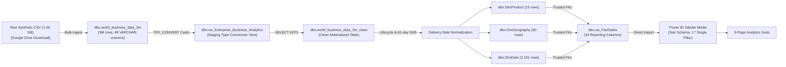
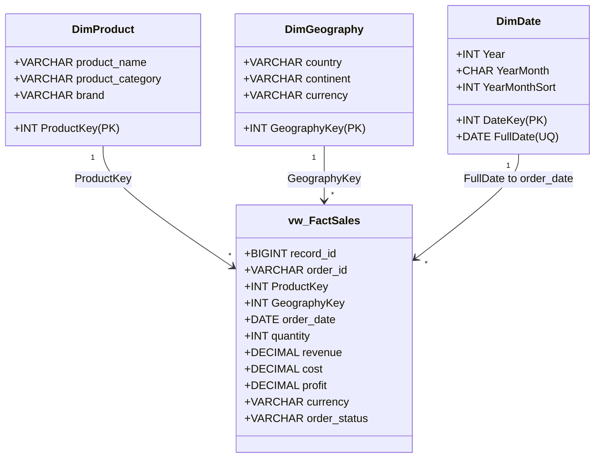

# Enterprise Global Business Analytics | 3M Synthetic Transactions

[](https://www.microsoft.com/en-us/sql-server/sql-server-downloads)
[](https://learn.microsoft.com/en-us/sql/ssms/download-sql-server-management-studio-ssms)
[](https://powerbi.microsoft.com/desktop/)
[](https://github.com/sabledattatray/enterprise-global-business-analytics-3m/actions)
[](https://dattasable.com)
[](LICENSE)
[](docs/TECHNICAL_AUDIT_REPORT.md)
[](https://dattasable.com)

> **Project Author & Owner:** [Datta Sable](https://dattasable.com)  
> **Source Dataset:** 3,000,000 Synthetic International Business Transactions (1,299,034,854 bytes / 1.30 GB)  
> **SHA-256 Checksum:** `F4E8F1747985E9D1A6D18763699994585FE29840DA44124D41DD5024CFB1616C`  
> 📥 **Dataset Direct Download:** [Download Full 3M CSV from Google Drive](https://drive.google.com/file/d/1qT-9U-xVM0GlPSyNEoaroIBIA8X05CmK/view?usp=sharing)  
> 🔬 **Lightweight Testing Sample:** [`data/samples/sample_100_rows.csv`](data/samples/sample_100_rows.csv) (53.8 KB)

---

## 1. Executive Summary & Purpose

An enterprise-grade, audit-first Business Intelligence portfolio demonstrating an end-to-end data engineering and semantic modeling pipeline on **3,000,000 synthetic transaction records**. 

Starting from an immutable 49-column `VARCHAR(50)` raw CSV dataset, this repository details the complete data journey through Microsoft SQL Server 2022: raw data profiling, explicit type casting via staging views, materialization of a clean physical reporting table, dimensional remodeling with surrogate keys, referential integrity enforcement, and a Kimball star schema imported into Microsoft Power BI Desktop across nine structured analytics pages.

Unlike typical showcase projects that overlook synthetic data generator flaws, this repository adheres to **complete technical truthfulness**: it documents and enforces rigorous engineering guardrails against **42-currency arithmetic aggregation** and **synthetic customer identifier collisions**.

---

## 2. Implementation & Delivery Status Matrix

To provide complete transparency for technical reviewers and hiring managers, this project separates the verified data modeling and engineering foundation from the report visual authoring phase:

| Architecture Layer | Component / Deliverable | Scope / Detail | Verification & Delivery Status | Evidence & Test Location |
|---|---|---|:---:|---|
| **SQL Data Pipeline** | 13 T-SQL Scripts (`sql/00` to `sql/12`) | Ingestion, typing, 81-day shift, surrogate keys, 3 dimensions, views, FKs | **100% PRODUCTION VERIFIED** | 12/12 automated SQL tests pass on 3M rows (`tests/sql/run_all_sql_tests.ps1`) |
| **Tabular Semantic Model** | VertiPaq Data Model (`.pbix`) | Kimball star schema, 4 tables, 3 single-direction `1:*` active relationships | **100% MODEL VERIFIED** | 3,000,000 rows imported; 214 MB in-memory model (`docs/POWERBI_MODEL_VALIDATION.md`) |
| **DAX Measure Catalog** | 4 DAX Libraries (`powerbi/measures/`) | Base, Operations, Date, and P0 Currency-Gated Financial measures | **100% PRODUCTION VERIFIED** | Static syntax and currency-guardrail CI audit passes (`tests/dax/validate_dax_logic.ps1`) |
| **Visual Design Tokens** | Theme JSON, 260 Icons, Canvas | Corporate navy tokens (`#061B3A`, `#1769E0`), 65 icon concepts, 1536×1024 background | **100% ASSETS VERIFIED** | Asset integrity and JSON schema validation passes (`tests/asset_checks/verify_assets.ps1`) |
| **Page Specifications & Design Mockups** | 9 Markdown Specs & 11 UI Layouts | Layout grids, card bindings, slicer matrices, and target UI reference mockups | **100% SPEC COMPLETED** | Published in [`powerbi/page-specs/`](powerbi/page-specs/) & [`assets/screenshots/`](assets/screenshots/) |
| **Native Multi-Page Desktop Visuals** | Power BI Desktop Report Canvas | Page 01 Executive layout created; Pages 02–09 native drag-and-drop authoring in progress | **AUTHORING / SPEC PHASE** | Page 01 operational; Pages 02–09 documented with complete field-level binding specs |

---

## 3. Dashboard UI Design Mockups & Layout Targets

The visual design system reflects a modern corporate light theme: an 18% persistent deep-navy sidebar (`#061B3A` to `#0A2854`) anchored by a glowing 3D digital Earth network globe, paired with a spacious near-white canvas (`#F7FAFE`) with 1px hairline card borders (`#DFE7F2`).

> [!NOTE]
> **Visual Artifact Disclosure:**  
> The dashboard images below represent the **high-resolution UI design target mockups and layout specifications** created to guide report visual authoring in Power BI Desktop. Page 01 (Executive Overview) has been laid out in the desktop model (`Main Work.pbix`); Pages 02 through 09 are documented with complete field-level binding specifications in [`powerbi/page-specs/`](powerbi/page-specs/).

### Executive Overview (Page 01 Target Layout)


<details>
<summary><b>📸 Click to expand the 9-Page Dashboard Showcase Gallery (UI Design Mockups)</b></summary>
<br/>

| Page 02: Sales Performance | Page 03: Product Analysis |
|:---:|:---:|
|  |  |

| Page 04: Transaction & Channel Insights | Page 05: Region Analysis |
|:---:|:---:|
|  |  |

| Page 06: Order Details (Drill-Through Grid) | Page 07: Profitability Analysis (Currency-Gated) |
|:---:|:---:|
|  |  |

| Page 08: Order Exceptions & Cancellations | Page 09: Trend Analysis & Forecast Roadmap |
|:---:|:---:|
|  |  |

</details>

---

## 4. Verified Core Facts & Baseline Metrics

All metrics below were audited and verified directly against the live SQL Server 2022 database `[3 _M]` and Power BI tabular model:

| Dimension / Metric | Measured Baseline | Verification Status | Architectural Evidence |
|---|---|:---:|---|
| **Raw Transaction Volume** | **3,000,000 rows** | `VERIFIED` | `SELECT COUNT_BIG(*) FROM dbo.world_business_data_3m` |
| **Clean Physical Table** | **3,000,000 rows** | `VERIFIED` | `SELECT COUNT_BIG(*) FROM dbo.world_business_data_3m_clean` |
| **Fact View Rows** | **3,000,000 rows** | `VERIFIED` | `SELECT COUNT_BIG(*) FROM dbo.vw_FactSales` (19 columns) |
| **Fact Table Grain** | **1 row = 1 order = 1 transaction** | `VERIFIED` | 3,000,000 distinct order, record, and transaction IDs |
| **Catalog Products** | **15 validated products** | `VERIFIED` | `dbo.DimProduct` joined via surrogate `ProductKey` |
| **Geographic Coverage** | **50 countries / 6 continents**| `VERIFIED` | `dbo.DimGeography` joined via surrogate `GeographyKey` |
| **Local Currencies** | **42 currency codes** | `VERIFIED` | Two-tier currency policy enforced via DAX |
| **Calendar Coverage** | **2,191 calendar days** | `VERIFIED` | `dbo.DimDate` (2021-01-01 to 2026-12-31) |
| **Transaction Date Bounds**| **2021-10-12 to 2026-10-11** | `VERIFIED` | 1,826 distinct transaction days (81-day shift applied) |
| **Referential Integrity** | **3 Foreign Keys Trusted** | `VERIFIED` | Product, Geography, Date FKs enabled & trusted in SQL |
| **Financial Equality** | `profit = revenue - cost` | `VERIFIED` | 0 mismatches across 3,000,000 rows (cent tolerance) |
| **Delivered Status Volume** | **1,950,380 orders (65.01%)** | `VERIFIED` | `actual_delivery_date` populated exclusively for delivered |
| **Cancelled Status Volume**| **150,324 orders (5.01%)** | `VERIFIED` | Labeled strictly as cancellations, not customer returns |

---

## 5. End-to-End Pipeline Architecture



---

## 6. Critical Data Quality Guardrails (P0)

### 6.1 Multi-Currency Governance Guardrail
The dataset includes **42 distinct currencies**. Monetary fields represent local transaction currencies. A raw arithmetic sum across the dataset yields `18,720,460,798.92` — **this is an arithmetic illusion and has no economic meaning**.

**Remediation:** All monetary DAX measures enforce `HASONEVALUE(DimGeography[currency])`:
```dax
Revenue (Single Currency Only) = 
IF(
    HASONEVALUE(DimGeography[currency]),
    SUM(vw_FactSales[revenue]),
    BLANK()
)
```
When multiple currencies are in context, monetary visual cards return `BLANK()` with an explicit instructional prompt directing the user to filter by a single currency or country.

### 6.2 Customer Identity Defect Disclosure
In the synthetic source data, **801,192 customer IDs map to multiple names**, and **796,571 map to multiple countries** (e.g. `CUST-0659044` appears across 13 countries and 14 distinct person names).

**Remediation:** Unique-customer counts, customer retention rates, repeat buyer percentages, and Customer Lifetime Value (CLV) are **deliberately excluded**. Page 04 is titled **"Transaction & Channel Insights"**, evaluating **transaction-level behavioral patterns** (channel adoption, basket size distributions, and payment methods) with prominent disclosure callouts.

### 6.3 Product Surrogate Key Repair
Original source `product_id` values (1–15) mapped arbitrarily across all 15 product names. The stable combination `(product_name, product_category, brand)` was used to build `dbo.DimProduct` with surrogate integer `ProductKey`, completely eliminating dimension ambiguity.

---

## 7. Measured Performance Benchmarks

Performance was empirically measured on Microsoft SQL Server 2022 on host machine `DATTA` (Windows 11 Enterprise, NVMe SSD, 16+ GB RAM) across the full 3,000,000-row dataset using `System.Diagnostics.Stopwatch` (.NET) and `SET STATISTICS TIME, IO ON`. For hardware specs, cache procedures, and measurement methodology, see [docs/PERFORMANCE_BENCHMARK.md](docs/PERFORMANCE_BENCHMARK.md).

| Benchmark Workload | Query Shape | Rows Processed | Warm Duration | Cold Buffer | Peak Throughput |
|---|---|---:|---:|---:|---:|
| **Monthly Aggregation by Currency** | Full fact view scan grouped by Year, Month, Currency (4 aggregations) | 3,000,000 | **414 ms** | **1,138 ms** | **7.2M rows/sec** |
| **Star Schema 3-Way Join Slicing** | Fact view joined to DimProduct and DimGeography | 3,000,000 | **237 ms** | **2,586 ms** | **12.6M rows/sec** |
| **Headline Card Aggregation** | Single-pass Distinct Orders, Total Units, Avg Units | 3,000,000 | **315 ms** | **925 ms** | **9.5M rows/sec** |
| **Power BI Model Compression** | VertiPaq XPress9 columnar compression | 1.30 GB CSV | **214 MB in PBIX** | — | **6.1 : 1 Compression** |

### Reproduce Benchmarks Locally:
```powershell
powershell -ExecutionPolicy Bypass -File tests/sql/run_benchmarks.ps1
```

---

## 8. Power BI Semantic Model & Relationships

The Power BI model imports four dedicated SQL objects in a pure Kimball Star Schema:



- **Date Table Registered:** `DimDate` is formally marked as a Date Table using unique column `FullDate`.
- **Sort-By Columns:** `MonthName` sorted by `MonthNumber`; `YearMonth` sorted by integer `YearMonthSort`.
- **Relationship Properties:** Single cross-filter direction (1:*), active. Technical surrogate keys hidden from report view.

---

## 9. Nine-Page Feature Matrix & Technical Implementation Status

| Page | Title / Domain | Primary Focus | Design & Binding Spec | Operational Desktop Canvas | Detailed Specification |
|:---:|---|---|:---:|:---:|---|
| **01** | **Executive Overview** | Headline operational KPIs, freshness label, currency warning | `COMPLETE` | `CANVAS BUILT` | [Page 01 Spec](powerbi/page-specs/01_executive_overview.md) |
| **02** | **Sales Performance** | Monthly order pacing, MoM/YoY growth (distinguished from revenue) | `COMPLETE` | `AUTHORING PHASE` | [Page 02 Spec](powerbi/page-specs/02_sales_performance.md) |
| **03** | **Product Analysis** | 15 validated products, category share %, units per order | `COMPLETE` | `AUTHORING PHASE` | [Page 03 Spec](powerbi/page-specs/03_product_analysis.md) |
| **04** | **Transaction & Channel Insights** | Channel & payment behaviors (identity collision disclosed) | `COMPLETE` | `AUTHORING PHASE` | [Page 04 Spec](powerbi/page-specs/04_transaction_channel_insights.md) |
| **05** | **Region Analysis** | 50 countries, 42 currencies, continent map + table fallback | `COMPLETE` | `AUTHORING PHASE` | [Page 05 Spec](powerbi/page-specs/05_region_analysis.md) |
| **06** | **Order Details** | Transaction drill-through grid across all 19 fact columns with search | `COMPLETE` | `AUTHORING PHASE` | [Page 06 Spec](powerbi/page-specs/06_order_details.md) |
| **07** | **Profitability Analysis** | Currency-gated revenue, cost, profit, and margin waterfall | `COMPLETE` | `AUTHORING PHASE` | [Page 07 Spec](powerbi/page-specs/07_profitability_analysis.md) |
| **08** | **Order Exceptions** | Cancellations (150K) and status failures (returns excluded) | `COMPLETE` | `AUTHORING PHASE` | [Page 08 Spec](powerbi/page-specs/08_order_exceptions.md) |
| **09** | **Trend Analysis & Forecast Roadmap** | 5-year moving average trend decomposition + ML roadmap | `COMPLETE` | `AUTHORING PHASE` | [Page 09 Spec](powerbi/page-specs/09_trend_forecast_roadmap.md) |

---

## 10. Automated Testing & Verification Evidence

An automated PowerShell test runner executes the complete SQL test suite in seconds:

```powershell
powershell -ExecutionPolicy Bypass -File tests/sql/run_all_sql_tests.ps1
```

### Live Test Execution Log:
```text
Connected to SQL Server: [3 _M] on DATTA

=== EXECUTING AUTOMATED SQL VALIDATION SUITE ===
[PASS] SQL-01 - Raw Source Rows (Expected: 3000000, Actual: 3000000)
[PASS] SQL-02 - Clean Table Rows (Expected: 3000000, Actual: 3000000)
[PASS] SQL-03 - Fact View Rows (Expected: 3000000, Actual: 3000000)
[PASS] SQL-04 - Distinct Order IDs (Expected: 3000000, Actual: 3000000)
[PASS] SQL-05 - DimProduct Rows (Expected: 15, Actual: 15)
[PASS] SQL-06 - DimGeography Rows (Expected: 50, Actual: 50)
[PASS] SQL-07 - Distinct Currencies (Expected: 42, Actual: 42)
[PASS] SQL-08 - DimDate Calendar Days (Expected: 2191, Actual: 2191)
[PASS] SQL-09 - Unmapped Product Keys (Expected: 0, Actual: 0)
[PASS] SQL-10 - Unmapped Geography Keys (Expected: 0, Actual: 0)
[PASS] SQL-11 - Profit Reconciliation Mismatches (Expected: 0, Actual: 0)
[PASS] SQL-12 - Non-Delivered Actual Date Violations (Expected: 0, Actual: 0)

ALL 12 TESTS PASSED SUCCESSFULLY!
```

---

## 11. Quick Start & Reproduction Guide

### Prerequisites
1. Microsoft SQL Server 2022 Developer Edition installed on localhost.
2. Microsoft Power BI Desktop (October 2026 release or newer).
3. 25 GB free disk space.

### Step 1: Download the 3M Dataset
Download `world_business_data_3m.csv` (~1.3 GB) via Google Drive:  
👉 **[Download 3M Source Data from Google Drive](https://drive.google.com/file/d/1qT-9U-xVM0GlPSyNEoaroIBIA8X05CmK/view?usp=sharing)**

### Step 2: Database Ingestion & Pipeline Run
Follow the comprehensive step-by-step walkthrough in [docs/SQL_SERVER_SETUP.md](docs/SQL_SERVER_SETUP.md) to create database `[3 _M]`, bulk insert the CSV, and run scripts `sql/00` through `sql/12`.

### Step 3: Open Power BI & Apply Design System
Because the compiled VertiPaq `.pbix` is 214 MB (exceeding GitHub's 100 MB per-file tracking limit), binary `.pbix` files are excluded from Git commits via `.gitignore`. You can reproduce the exact data model in ~5 minutes by following [docs/POWER_BI_SETUP.md](docs/POWER_BI_SETUP.md):
1. Connect Power BI Desktop to local SQL instance `.` database `[3 _M]`.
2. Import `dbo.vw_FactSales`, `dbo.DimProduct`, `dbo.DimGeography`, and `dbo.DimDate`.
3. Apply [powerbi/theme/enterprise-light-theme.json](powerbi/theme/enterprise-light-theme.json).
4. Paste the DAX measures from `powerbi/measures/`.
5. Follow [powerbi/page-specs/](powerbi/page-specs/) to layout visuals on the registered background canvas.

---

## 12. Complete Technical Audit & Documentation Index

### Core Architecture & Modeling Documentation
- [PRD Specification v1.0](docs/PRD.md)
- [PRD v1.1 Final Technical Audit](docs/PRD%20v1.1)
- [System Architecture](docs/ARCHITECTURE.md)
- [Data Dictionary & Schemas](docs/DATA_DICTIONARY.md)
- [Data Quality & Known Generator Defects](docs/DATA_QUALITY_AND_LIMITATIONS.md)
- [Semantic Model Architecture](docs/SEMANTIC_MODEL.md)
- [DAX Measure Reference Catalog](docs/DAX_MEASURES.md)
- [Multi-Currency Governance Policy](docs/CURRENCY_POLICY.md)
- [Visual Design System & Brand Tokens](docs/VISUAL_DESIGN_SYSTEM.md)
- [SQL Server Setup Guide](docs/SQL_SERVER_SETUP.md)
- [SQL Transformation Walkthrough](docs/SQL_TRANSFORMATION_WALKTHROUGH.md)
- [Power BI Setup Walkthrough](docs/POWER_BI_SETUP.md)

### PRD v1.1 Audit Deliverables
- [Technical Architecture Review & Audit Report](docs/TECHNICAL_AUDIT_REPORT.md)
- [Data Quality Scorecard](docs/DATA_QUALITY_SCORECARD.md)
- [SQL Server Pipeline Reconciliation Report](docs/SQL_RECONCILIATION_REPORT.md)
- [Power BI Model Validation & Semantic Audit](docs/POWERBI_MODEL_VALIDATION.md)
- [DAX Financial Measures & Multi-Currency Audit](docs/DAX_CURRENCY_AUDIT.md)
- [Performance Benchmark & Engine Capacity Report](docs/PERFORMANCE_BENCHMARK.md)
- [Known Technical Limitations & Boundaries](docs/KNOWN_LIMITATIONS.md)
- [README & Documentation Improvement Report](docs/README_IMPROVEMENT_REPORT.md)
- [Production Release Checklist & Governance Sign-Off](docs/RELEASE_CHECKLIST.md)

---

## 13. License, Attribution & Contact

- **License:** Distributed under the [MIT License](LICENSE).
- **Project Owner / Brand:** [Datta Sable](https://dattasable.com)  
- **Website:** [https://dattasable.com](https://dattasable.com)  
- **Inquiries:** Contact via [dattasable.com](https://dattasable.com)
