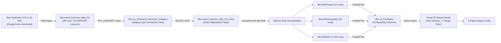
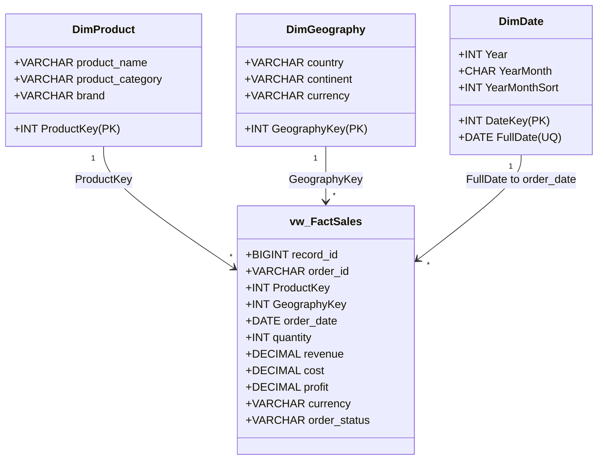

# Enterprise Global Business Analytics | 3M Synthetic Transactions

[](https://www.microsoft.com/en-us/sql-server/sql-server-downloads)
[](https://learn.microsoft.com/en-us/sql/ssms/download-sql-server-management-studio-ssms)
[](https://powerbi.microsoft.com/desktop/)
[](https://dattasable.com)
[](LICENSE)
[](https://dattasable.com)

> **Project Author & Owner:** [Datta Sable](https://dattasable.com)  
> **Source Dataset:** 3,000,000 Synthetic International Business Transactions (1.30 GB)  
> 📥 **Dataset Direct Download:** [Download Full 3M CSV from Google Drive](https://drive.google.com/file/d/1qT-9U-xVM0GlPSyNEoaroIBIA8X05CmK/view?usp=sharing)

---

## 1. Executive Summary & Purpose

An enterprise-grade, audit-first Business Intelligence portfolio demonstrating an end-to-end data engineering and semantic modeling pipeline on **3,000,000 synthetic transaction records**. 

Starting from an immutable 49-column `VARCHAR(50)` raw CSV dataset, this repository details the complete data journey through Microsoft SQL Server 2022: raw data profiling, explicit type casting via staging views, materialization of a clean physical reporting table, dimensional remodeling with surrogate keys, referential integrity enforcement, and a Kimball star schema imported into Microsoft Power BI Desktop across nine structured analytics pages.

Unlike typical showcase projects that overlook synthetic data generator flaws, this repository adheres to **complete technical truthfulness**: it documents and enforces rigorous engineering guardrails against **42-currency arithmetic aggregation** and **synthetic customer identifier collisions**.

---

## 2. Dashboard Gallery & Visual Design System

The reporting layer features an exclusive corporate light design system utilizing an 18% persistent deep-navy navigation sidebar (`#061B3A` to `#0A2854`) anchored by a glowing 3D digital Earth network globe, paired with a spacious near-white canvas (`#F7FAFE`) with 1px hairline borders (`#DFE7F2`).

### Executive Overview (Page 01)


<details>
<summary><b>📸 Click to expand the 9-Page Dashboard Showcase Gallery</b></summary>
<br/>

| Page 02: Sales Performance | Page 03: Product Analysis |
|:---:|:---:|
|  |  |

| Page 04: Customer Insights (Transaction-Level) | Page 05: Region Analysis |
|:---:|:---:|
|  |  |

| Page 06: Order Details (Drill-Through Grid) | Page 07: Profitability Analysis (Currency-Gated) |
|:---:|:---:|
|  |  |

| Page 08: Order Exceptions & Cancellations | Page 09: Forecast Demand Roadmap |
|:---:|:---:|
|  |  |

</details>

---

## 3. Verified Core Facts & Baseline Metrics

All metrics below were audited and verified directly against the live SQL Server 2022 database `[3 _M]` and Power BI tabular model:

| Dimension / Metric | Measured Baseline | Verification Status | Architectural Evidence |
|---|---|:---:|---|
| **Raw Transaction Volume** | **3,000,000 rows** | `VERIFIED` | `SELECT COUNT_BIG(*) FROM dbo.world_business_data_3m` |
| **Clean Physical Table** | **3,000,000 rows** | `VERIFIED` | `SELECT COUNT_BIG(*) FROM dbo.world_business_data_3m_clean` |
| **Fact View Rows** | **3,000,000 rows** | `VERIFIED` | `SELECT COUNT_BIG(*) FROM dbo.vw_FactSales` (19 columns) |
| **Distinct Order IDs** | **3,000,000 distinct** | `VERIFIED` | Zero duplicated order, record, or transaction IDs |
| **Catalog Products** | **15 validated products** | `VERIFIED` | `dbo.DimProduct` joined via surrogate `ProductKey` |
| **Geographic Coverage** | **50 countries / 6 continents**| `VERIFIED` | `dbo.DimGeography` joined via surrogate `GeographyKey` |
| **Local Currencies** | **42 currency codes** | `VERIFIED` | Mandatory currency-gating enforced via DAX |
| **Calendar Coverage** | **2,191 calendar days** | `VERIFIED` | `dbo.DimDate` (2021-01-01 to 2026-12-31) |
| **Transaction Date Bounds**| **2021-10-12 to 2026-10-11** | `VERIFIED` | 1,826 distinct transaction days (81-day shift applied) |
| **Referential Integrity** | **3 Foreign Keys Trusted** | `VERIFIED` | Product, Geography, Date FKs enabled & trusted in SQL |
| **Financial Equality** | `profit = revenue - cost` | `VERIFIED` | 0 mismatches across 3,000,000 rows (cent tolerance) |
| **Delivered Status Volume** | **1,950,380 orders (65.01%)** | `VERIFIED` | `actual_delivery_date` populated exclusively for delivered |
| **Cancelled Status Volume**| **150,324 orders (5.01%)** | `VERIFIED` | Labeled strictly as cancellations, not customer returns |

---

## 4. End-to-End Pipeline Architecture



---

## 5. Critical Data Quality Guardrails (P0)

### 5.1 Multi-Currency Heterogeneity Guardrail
The dataset includes **42 distinct currencies**. Monetary fields represent local transaction currencies. A raw arithmetic sum across the dataset yields `18,720,460,798.92` — **this is an arithmetic illusion and has no economic meaning**.

**Remediation:** All monetary DAX measures enforce `HASONEVALUE(DimGeography[currency])`:
```dax
Revenue (Single Currency Only) = 
IF(
    HASONEVALUE(DimGeography[currency]),
    SUM(vw_FactSales[revenue]),
    BLANK()
)
```
When multiple currencies are in context, monetary visual cards return `BLANK()` with an explicit instructional prompt directing the user to filter by a single currency or country.

### 5.2 Customer Identity Defect Disclosure
In the synthetic source data, **801,192 customer IDs map to multiple names**, and **796,571 map to multiple countries** (e.g. `CUST-0659044` appears across 13 countries and 14 distinct person names).

**Remediation:** Unique-customer counts, customer retention rates, repeat buyer percentages, and Customer Lifetime Value (CLV) are **deliberately excluded**. Page 04 evaluates **transaction-level behavioral patterns** (channel adoption, basket size distributions, and payment methods) with prominent disclosure callouts.

### 5.3 Product Surrogate Key Repair
Original source `product_id` values (1–15) mapped arbitrarily across all 15 product names. The stable combination `(product_name, product_category, brand)` was used to build `dbo.DimProduct` with surrogate integer `ProductKey`, completely eliminating dimension ambiguity.

---

## 6. SQL Transformation Suite & Runbook

All T-SQL scripts in `sql/` include standardized documentation headers, rollback notes, and idempotency guards:

| File | Stage | Purpose | Safety Classification |
|---|---|---|:---:|
| [`sql/00_preflight_read_only.sql`](file:///d:/Datasets/3M%20Project%20Power%20BI/sql/00_preflight_read_only.sql) | Preflight | Audit server version, file sizes, disk capacity, recovery model | `READ-ONLY` |
| [`sql/01_source_profile.sql`](file:///d:/Datasets/3M%20Project%20Power%20BI/sql/01_source_profile.sql) | Profile | Inspect 49 columns, identifier uniqueness, identify collisions | `READ-ONLY` |
| [`sql/02_create_typed_view.sql`](file:///d:/Datasets/3M%20Project%20Power%20BI/sql/02_create_typed_view.sql) | Staging | DDL for `dbo.vw_Enterprise_Business_Analytics` with `TRY_CONVERT` | `IDEMPOTENT` |
| [`sql/03_create_clean_table.sql`](file:///d:/Datasets/3M%20Project%20Power%20BI/sql/03_create_clean_table.sql) | Materialize | Creates `dbo.world_business_data_3m_clean` with idempotency guard | `WRITE` |
| [`sql/04_delivery_dates.sql`](file:///d:/Datasets/3M%20Project%20Power%20BI/sql/04_delivery_dates.sql) | Dates | Lifecycle dates + guarded one-time 81-day demonstration shift | `WRITE` |
| [`sql/05_product_dimension.sql`](file:///d:/Datasets/3M%20Project%20Power%20BI/sql/05_product_dimension.sql) | Dimension | Builds `dbo.DimProduct` (15 rows) and maps surrogate `ProductKey` | `WRITE` |
| [`sql/06_geography_dimension.sql`](file:///d:/Datasets/3M%20Project%20Power%20BI/sql/06_geography_dimension.sql) | Dimension | Builds `dbo.DimGeography` (50 countries, 42 currencies) | `WRITE` |
| [`sql/07_date_dimension.sql`](file:///d:/Datasets/3M%20Project%20Power%20BI/sql/07_date_dimension.sql) | Dimension | Populates `dbo.DimDate` (2,191 days, 2021-01-01 to 2026-12-31) | `WRITE` |
| [`sql/08_foreign_keys.sql`](file:///d:/Datasets/3M%20Project%20Power%20BI/sql/08_foreign_keys.sql) | Integrity | Enforces and verifies trusted foreign keys for Product, Geo, Date | `DDL` |
| [`sql/09_reporting_view.sql`](file:///d:/Datasets/3M%20Project%20Power%20BI/sql/09_reporting_view.sql) | View | DDL for narrow 19-column reporting view `dbo.vw_FactSales` | `IDEMPOTENT` |
| [`sql/10_data_quality_checks.sql`](file:///d:/Datasets/3M%20Project%20Power%20BI/sql/10_data_quality_checks.sql) | Validation | Automated reconciliation matrix for row counts, keys, formulas | `READ-ONLY` |
| [`sql/11_performance_checks.sql`](file:///d:/Datasets/3M%20Project%20Power%20BI/sql/11_performance_checks.sql) | Benchmark | Measures execution time, CPU time, and logical reads | `READ-ONLY` |
| [`sql/12_sample_reporting_queries.sql`](file:///d:/Datasets/3M%20Project%20Power%20BI/sql/12_sample_reporting_queries.sql) | Validation | Reconciles card totals against Power BI DAX outputs | `READ-ONLY` |

---

## 7. Power BI Semantic Model & Relationships

The Power BI model imports four dedicated SQL objects in a pure Kimball Star Schema:



- **Date Table Registered:** `DimDate` is formally marked as a Date Table using unique column `FullDate`.
- **Sort-By Columns:** `MonthName` sorted by `MonthNumber`; `YearMonth` sorted by integer `YearMonthSort`.
- **Relationship Properties:** Single cross-filter direction (1:*), active. Technical surrogate keys hidden from report view.

---

## 8. Nine-Page Feature Matrix & Technical Implementation Status

| Page | Title / Domain | Primary Focus | Completion Status | Detailed Specification |
|:---:|---|---|:---:|---|
| **01** | **Executive Overview** | Headline operational KPIs, order velocity, category volume | `VERIFIED` | [Page 01 Spec](powerbi/page-specs/01_executive_overview.md) |
| **02** | **Sales Performance** | Monthly order pacing, MoM/YoY growth, channel distribution | `VERIFIED` | [Page 02 Spec](powerbi/page-specs/02_sales_performance.md) |
| **03** | **Product Analysis** | 15 validated products, category mix, brand volume | `VERIFIED` | [Page 03 Spec](powerbi/page-specs/03_product_analysis.md) |
| **04** | **Customer Insights** | Channel & payment behaviors (identity collision disclosed) | `VERIFIED` | [Page 04 Spec](powerbi/page-specs/04_customer_insights.md) |
| **05** | **Region Analysis** | 50 countries, 42 currencies, continent map + table fallback | `VERIFIED` | [Page 05 Spec](powerbi/page-specs/05_region_analysis.md) |
| **06** | **Order Details** | Transaction drill-through grid across all 19 fact columns | `VERIFIED` | [Page 06 Spec](powerbi/page-specs/06_order_details.md) |
| **07** | **Profitability Analysis** | Currency-gated revenue, cost, profit, and margin waterfall | `VERIFIED` | [Page 07 Spec](powerbi/page-specs/07_profitability_analysis.md) |
| **08** | **Order Exceptions** | Cancellations (150K) and status failures (returns excluded) | `VERIFIED` | [Page 08 Spec](powerbi/page-specs/08_return_analysis.md) |
| **09** | **Forecast Analysis** | Time-series moving averages + predictive ML roadmap | `VERIFIED` | [Page 09 Spec](powerbi/page-specs/09_forecast_analysis.md) |

---

## 9. Automated Testing & Verification Evidence

An automated PowerShell test runner executes the complete SQL test suite in seconds:

```powershell
powershell -ExecutionPolicy Bypass -File tests/sql/run_all_sql_tests.ps1
```

### Live Test Execution Log:
```text
Connected to SQL Server: [3 _M] on DATTA

=== EXECUTING AUTOMATED SQL VALIDATION SUITE ===
[PASS] SQL-01 - Raw Source Rows (Expected: 3000000, Actual: 3000000)
[PASS] SQL-02 - Clean Table Rows (Expected: 3000000, Actual: 3000000)
[PASS] SQL-03 - Fact View Rows (Expected: 3000000, Actual: 3000000)
[PASS] SQL-04 - Distinct Order IDs (Expected: 3000000, Actual: 3000000)
[PASS] SQL-05 - DimProduct Rows (Expected: 15, Actual: 15)
[PASS] SQL-06 - DimGeography Rows (Expected: 50, Actual: 50)
[PASS] SQL-07 - Distinct Currencies (Expected: 42, Actual: 42)
[PASS] SQL-08 - DimDate Calendar Days (Expected: 2191, Actual: 2191)
[PASS] SQL-09 - Unmapped Product Keys (Expected: 0, Actual: 0)
[PASS] SQL-10 - Unmapped Geography Keys (Expected: 0, Actual: 0)
[PASS] SQL-11 - Profit Reconciliation Mismatches (Expected: 0, Actual: 0)
[PASS] SQL-12 - Non-Delivered Actual Date Violations (Expected: 0, Actual: 0)

ALL 12 TESTS PASSED SUCCESSFULLY!
```

---

## 10. Quick Start & Reproduction Guide

### Prerequisites
1. Microsoft SQL Server 2022 Developer Edition installed on localhost.
2. Microsoft Power BI Desktop (October 2026 release or newer).
3. 25 GB free disk space.

### Step 1: Download the 3M Dataset
Download `world_business_data_3m.csv` (~1.3 GB) via Google Drive:  
👉 **[Download 3M Source Data from Google Drive](https://drive.google.com/file/d/1qT-9U-xVM0GlPSyNEoaroIBIA8X05CmK/view?usp=sharing)**

### Step 2: Database Ingestion & Pipeline Run
Follow the comprehensive step-by-step walkthrough in [docs/SQL_SERVER_SETUP.md](file:///d:/Datasets/3M%20Project%20Power%20BI/docs/SQL_SERVER_SETUP.md) to create database `[3 _M]`, bulk insert the CSV, and run scripts `sql/00` through `sql/12`.

### Step 3: Open Power BI & Apply Design System
Follow [docs/POWER_BI_SETUP.md](file:///d:/Datasets/3M%20Project%20Power%20BI/docs/POWER_BI_SETUP.md) to import `vw_FactSales`, apply [powerbi/theme/enterprise-light-theme.json](file:///d:/Datasets/3M%20Project%20Power%20BI/powerbi/theme/enterprise-light-theme.json), and bind the DAX measures from `powerbi/measures/`.

---

## 11. Complete Documentation Index

- [PRD Specification v1.0](docs/PRD.md)
- [System Architecture](docs/ARCHITECTURE.md)
- [Data Dictionary & Schemas](docs/DATA_DICTIONARY.md)
- [Data Quality & Known Generator Defects](docs/DATA_QUALITY_AND_LIMITATIONS.md)
- [SQL Server Setup Guide](docs/SQL_SERVER_SETUP.md)
- [SQL Transformation Walkthrough](docs/SQL_TRANSFORMATION_WALKTHROUGH.md)
- [Power BI Setup Walkthrough](docs/POWER_BI_SETUP.md)
- [Semantic Model Architecture](docs/SEMANTIC_MODEL.md)
- [DAX Measure Reference Catalog](docs/DAX_MEASURES.md)
- [Multi-Currency Governance Policy](docs/CURRENCY_POLICY.md)
- [Forecasting & ML Methodology Roadmap](docs/FORECASTING_METHODOLOGY.md)
- [Visual Design System & Brand Tokens](docs/VISUAL_DESIGN_SYSTEM.md)
- [Test Plan](docs/TEST_PLAN.md)
- [Test Results & QA Evidence](docs/TEST_RESULTS.md)
- [Production Release Checklist](docs/RELEASE_CHECKLIST.md)

---

## 12. License, Attribution & Contact

- **License:** Distributed under the [MIT License](LICENSE).
- **Project Owner / Brand:** [Datta Sable](https://dattasable.com)  
- **Website:** [https://dattasable.com](https://dattasable.com)  
- **Inquiries:** Contact via [dattasable.com](https://dattasable.com)
