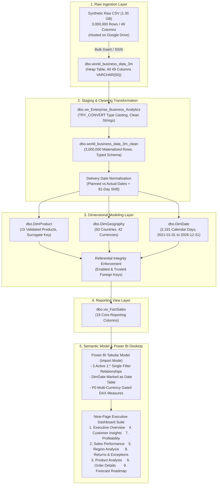

# System Architecture & Technical Flow

**Project:** Enterprise Global Business Analytics — 3M Synthetic Transactions  
**Target Architecture:** End-to-End Enterprise Data Pipeline (CSV → SQL Server 2022 → Star Schema → Power BI Desktop)  
**Author:** Datta Sable (https://dattasable.com)  
**Source Data Download Link:** [Download 3M Source Data from Google Drive](https://drive.google.com/file/d/1qT-9U-xVM0GlPSyNEoaroIBIA8X05CmK/view?usp=sharing)  

---

## 1. High-Level Architecture Diagram

---

## 2. Component Descriptions

### Ingestion Layer (`dbo.world_business_data_3m`)
- Acts as the immutable landing table.
- All 49 columns are stored as `VARCHAR(50)` to preserve raw source values exactly as generated without truncation or coercion errors.
- Never updated or mutated in place.

### Cleaning & Transformation Layer (`dbo.world_business_data_3m_clean`)
- Converts string values into strongly typed SQL Server data types (`BIGINT`, `DATE`, `DECIMAL(18,2)`, `DECIMAL(5,2)`, `INT`, `BIT`).
- Populates `planned_delivery_date` across all records and `actual_delivery_date` exclusively for delivered orders.
- Applies the synthetic 81-day shift to align transactions with the demonstration cutoff date (2026-10-25).

### Dimensional Layer (`DimProduct`, `DimGeography`, `DimDate`)
- **Product Dimension:** Bypasses unreliable source `product_id` and establishes 15 clean, 1-to-1 unique product entities joined on `(product_name, product_category, brand)`.
- **Geography Dimension:** Maps 50 countries, 6 continents, and 42 local currency codes.
- **Date Dimension:** Fully materialized calendar table spanning 6 calendar years (2,191 dates) with fiscal quarters, year-month sort keys, and weekend flags.

### Reporting Layer (`dbo.vw_FactSales`)
- A narrow, high-performance view exposing only the 19 columns required for reporting.
- Avoids duplicating 3 million physical rows in SQL Server storage while reducing Power BI Import memory footprint.

### Presentation Layer (Power BI Desktop)
- Star schema with single-direction dimension-to-fact relationships.
- DAX measure table `_Measures` enforcing currency safety via `HASONEVALUE`.
- Corporate light design theme (`#061B3A`, `#1769E0`, `#F7FAFE`) with 3D digital earth globe branding.
