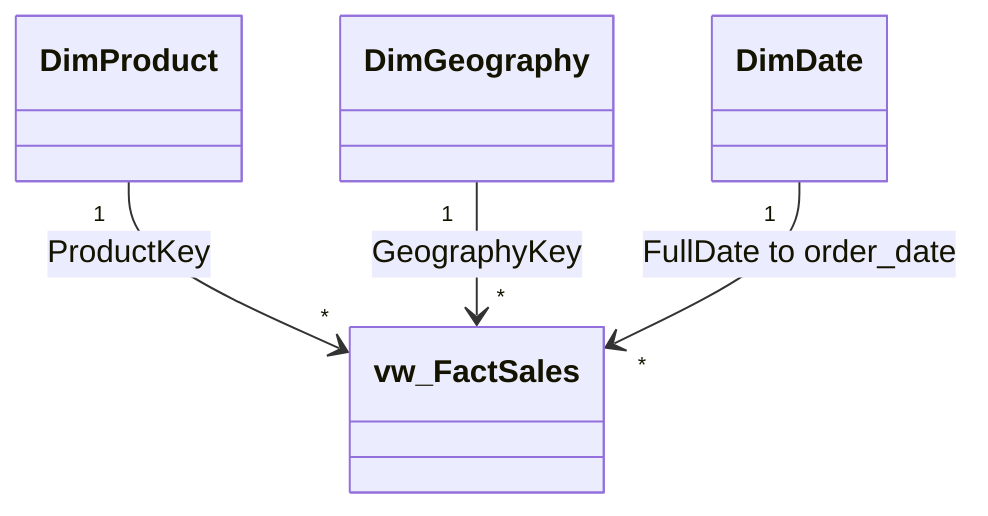

# Power BI Setup & Model Authoring Walkthrough

**Platform:** Microsoft Power BI Desktop (October 2026 Release / Version 2.159.229.0)  
**Target Mode:** Import Mode  
**Architecture:** Kimball Star Schema  
**Author:** Datta Sable (https://dattasable.com)  
**Source Data Download Link:** [Download 3M Source Data from Google Drive](https://drive.google.com/file/d/1qT-9U-xVM0GlPSyNEoaroIBIA8X05CmK/view?usp=sharing)  

---

## 1. Prerequisites & Clean Import Strategy

- Install the latest version of [Microsoft Power BI Desktop](https://powerbi.microsoft.com/desktop/).
- Ensure local SQL Server instance is running with database `[3 _M]`.

> [!IMPORTANT]
> **SELECTIVE IMPORT RULE (PRD Section 7.1):**  
> In Power BI Navigator, import **ONLY** the following four objects:
> 1. `dbo.vw_FactSales` (Narrow reporting fact view — 3M rows, 19 columns)
> 2. `dbo.DimProduct` (15 rows)
> 3. `dbo.DimGeography` (50 rows)
> 4. `dbo.DimDate` (2,191 rows)
> 
> **DO NOT** import `dbo.world_business_data_3m` or `dbo.world_business_data_3m_clean`. Importing wide raw tables duplicates memory and slows down model refresh without analytical benefit.

---

## 2. Step-by-Step Connection Instructions

1. Open Power BI Desktop. Click **Get Data** → **SQL Server**.
2. **Server:** `.` (or `localhost`)
3. **Database:** `3 _M` (include the space)
4. **Data Connectivity mode:** Select **Import**.
5. In the Navigator window, select:
   - `vw_FactSales`
   - `DimProduct`
   - `DimGeography`
   - `DimDate`
6. Click **Load**. (Importing 3M rows takes ~45–90 seconds depending on local RAM).

---

## 3. Modeling & Relationship Configuration

Open the **Model View** and establish the three single-direction 1-to-many relationships:

1. Drag `DimProduct[ProductKey]` → `vw_FactSales[ProductKey]`:
   - Cardinality: **One to Many (1:*)**
   - Cross filter direction: **Single**
   - Make this relationship active: **Checked**
2. Drag `DimGeography[GeographyKey]` → `vw_FactSales[GeographyKey]`:
   - Cardinality: **One to Many (1:*)**
   - Cross filter direction: **Single**
   - Make this relationship active: **Checked**
3. Drag `DimDate[FullDate]` → `vw_FactSales[order_date]`:
   - Cardinality: **One to Many (1:*)**
   - Cross filter direction: **Single**
   - Make this relationship active: **Checked**

### Date Table Configuration
- Right-click `DimDate` in the Data pane → **Mark as Date Table**.
- Select **Date column:** `FullDate`. Click **OK**.
- Select `DimDate[MonthName]`, go to **Column Tools** → **Sort by column** → Select `MonthNumber`.
- Select `DimDate[YearMonth]`, go to **Column Tools** → **Sort by column** → Select `YearMonthSort`.

---

## 4. Measure Table & DAX Integration

1. Go to **Home** → **Enter Data**.
2. Name the table `_Measures` and click **Load**.
3. Create the DAX measures documented in `powerbi/measures/`:
   - `base_measures.dax`: `Total Orders`, `Total Units Sold`, `Average Units Per Order`
   - `finance_measures.dax`: `Revenue (Single Currency Only)`, `Profit (Single Currency Only)`, `Profit Margin (Single Currency Only)`
   - `operations_measures.dax`: `Delivered Orders`, `Cancelled Orders`, `Delivery Completion Rate`, `Cancellation Rate`
   - `date_measures.dax`: `Orders YTD`, `Orders MTD`, `Orders MoM % Change`
4. Hide the dummy `Column1` in `_Measures` to display the calculator icon for the table.

---

## 5. Visual Theme & Canvas Setup

1. In Power BI Desktop, navigate to **View** → **Themes** dropdown → **Browse for themes...**
2. Select `powerbi/theme/enterprise-light-theme.json`.
3. In Report View, select the canvas background:
   - Format Page → **Canvas background**
   - Click **Image** → Browse to `assets/backgrounds/Futuristic Blue Earth Dashboard Background.png`
   - Image fit: **Fit** or **Normal** (Transparency: **0%**)
4. Follow the 9 page layout specifications in `powerbi/page-specs/` to assemble each analytics view.
