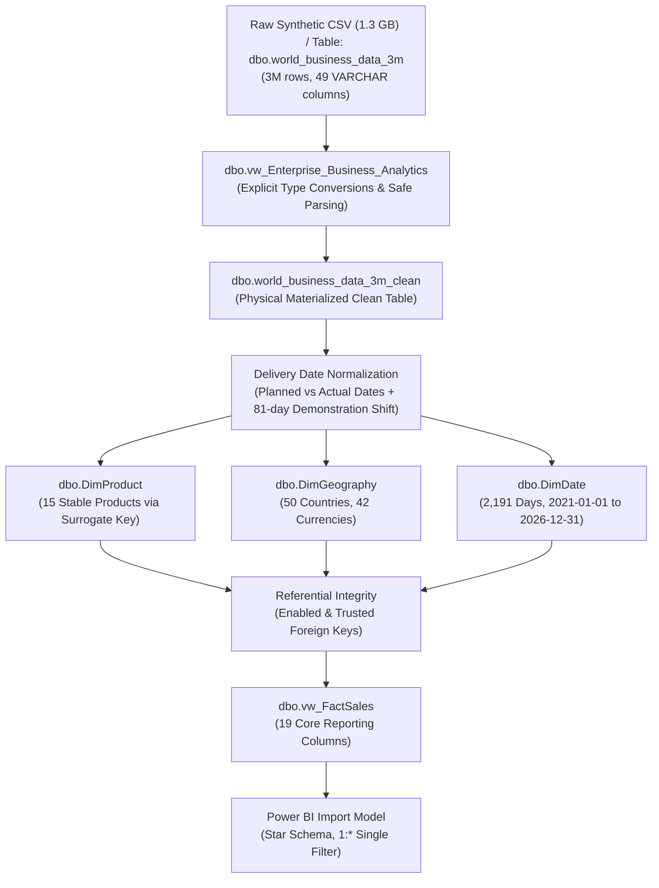

# SQL Server 2022 Transformation Pipeline Runbook

**Database:** `[3 _M]`  
**Engine:** Microsoft SQL Server 2022 Developer Edition / SSMS 22  
**Dataset:** 3,000,000 synthetic international business transactions  
**Source CSV Download Link:** [Download 3M Source Data from Google Drive](https://drive.google.com/file/d/1qT-9U-xVM0GlPSyNEoaroIBIA8X05CmK/view?usp=sharing)  

---

## 1. Pipeline Architecture

---

## 2. Script Execution Order & Safety Classification

| Order | Script File | Purpose | Safety Classification | Expected Runtime |
|---|---|---|---|---|
| **00** | `00_preflight_read_only.sql` | Database existence, disk space, file allocation, connection audit | **READ-ONLY (Safe)** | < 1 second |
| **01** | `01_source_profile.sql` | 49-column VARCHAR inspection, row counts, identifier uniqueness | **READ-ONLY (Safe)** | 5–15 seconds |
| **02** | `02_create_typed_view.sql` | DDL for `dbo.vw_Enterprise_Business_Analytics` staging view | **IDEMPOTENT (Safe)** | < 1 second |
| **03** | `03_create_clean_table.sql` | Materializes `dbo.world_business_data_3m_clean` with idempotency guard | **WRITE / MATERIALIZATION** | ~45–75 seconds |
| **04** | `04_delivery_dates.sql` | Populates planned vs actual delivery; documents synthetic 81-day shift | **WRITE (One-Time Only)** | ~30 seconds |
| **05** | `05_product_dimension.sql` | Builds `dbo.DimProduct` (15 rows) and populates `ProductKey` | **WRITE / DDL** | ~20 seconds |
| **06** | `06_geography_dimension.sql`| Builds `dbo.DimGeography` (50 rows) and populates `GeographyKey` | **WRITE / DDL** | ~20 seconds |
| **07** | `07_date_dimension.sql` | Generates 2,191 dates in `dbo.DimDate` (2021-01-01 to 2026-12-31) | **WRITE / DDL** | ~2 seconds |
| **08** | `08_foreign_keys.sql` | Enforces and verifies trusted foreign keys for Product, Geo, Date | **DDL / CONSTRAINT** | ~10 seconds |
| **09** | `09_reporting_view.sql` | DDL for narrow reporting view `dbo.vw_FactSales` (19 columns) | **IDEMPOTENT (Safe)** | < 1 second |
| **10** | `10_data_quality_checks.sql`| Reconciles financial formulas, zero orphan keys, null delivery rules | **READ-ONLY (Safe)** | ~15–30 seconds |
| **11** | `11_performance_checks.sql` | Benchmarks logical reads, CPU time, and execution statistics | **READ-ONLY (Safe)** | ~2–5 seconds |
| **12** | `12_sample_reporting_queries.sql`| Analytical queries matching Power BI card/visual aggregates | **READ-ONLY (Safe)** | ~2–5 seconds |

---

## 3. Critical Pre-Flight Rules

1. **Space Requirements:** The raw table takes ~1.5 GB; the clean table takes ~1.47 GB. Ensure at least 10 GB free space on the host drive to accommodate transaction log growth during one-time materialization.
2. **Date Shift Warning:** The 81-day backward date adjustment was performed exclusively on the demonstration clean table to prevent future-dated transactions past the project cutoff date (2026-10-25). **Never reapply the DATEADD operation** on an already shifted clean table.
3. **Multi-Currency Warning:** There are 42 distinct currency codes in the dataset. Script `12_sample_reporting_queries.sql` groups by currency to avoid invalid arithmetic aggregations.
